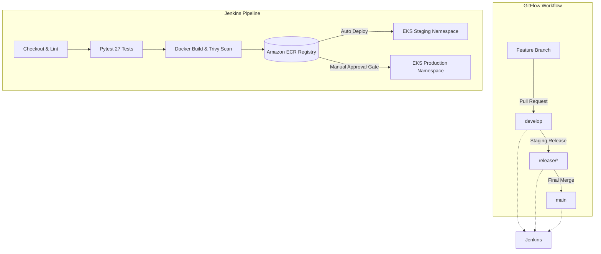

# AWS EKS & GitFlow Deployment Guide: Pet Adoption System

## 1. Overview & Architecture
This guide provides complete instructions for configuring, deploying, monitoring, rolling back, and troubleshooting the Pet Adoption & Management System on **Amazon Web Services (AWS)** using **Amazon ECR**, **Amazon EKS**, and **Jenkins**.



---

## 2. Prerequisites & CLI Installation
Ensure the following tools are installed on your administrative workstation and Jenkins runner:
- **AWS CLI v2**: `aws --version`
- **Docker**: `docker --version`
- **kubectl**: `kubectl version --client`
- **eksctl**: `eksctl version`

---

## 3. AWS Infrastructure Setup (Least-Privilege)

### 3.1 IAM Policy for Jenkins Runner
Create a custom IAM policy named `JenkinsEKSECRPolicy` with least-privilege permissions:

```json
{
  "Version": "2012-10-17",
  "Statement": [
    {
      "Sid": "ECRAuthorization",
      "Effect": "Allow",
      "Action": [
        "ecr:GetAuthorizationToken"
      ],
      "Resource": "*"
    },
    {
      "Sid": "ECRRepositoryActions",
      "Effect": "Allow",
      "Action": [
        "ecr:BatchCheckLayerAvailability",
        "ecr:GetDownloadUrlForLayer",
        "ecr:GetRepositoryPolicy",
        "ecr:DescribeRepositories",
        "ecr:ListImages",
        "ecr:DescribeImages",
        "ecr:BatchGetImage",
        "ecr:InitiateLayerUpload",
        "ecr:UploadLayerPart",
        "ecr:CompleteLayerUpload",
        "ecr:PutImage",
        "ecr:CreateRepository"
      ],
      "Resource": "arn:aws:ecr:*:*:repository/pet-adoption-system"
    },
    {
      "Sid": "EKSClusterAccess",
      "Effect": "Allow",
      "Action": [
        "eks:DescribeCluster",
        "eks:ListClusters"
      ],
      "Resource": "*"
    }
  ]
}
```

### 3.2 Create Amazon ECR Repository with Immutable Tags
```bash
aws ecr create-repository \
    --repository-name pet-adoption-system \
    --image-tag-mutability IMMUTABLE \
    --image-scanning-configuration scanOnPush=true \
    --region us-east-1
```

### 3.3 Provision Amazon EKS Cluster
Deploy a managed Kubernetes cluster using `eksctl`:
```bash
eksctl create cluster \
    --name pet-adoption-eks \
    --region us-east-1 \
    --nodegroup-name pet-app-workers \
    --node-type t3.medium \
    --nodes 2 \
    --nodes-min 2 \
    --nodes-max 4 \
    --managed
```

### 3.4 Configure Local kubeconfig
```bash
aws eks update-kubeconfig --region us-east-1 --name pet-adoption-eks
kubectl get nodes
```

---

## 4. Jenkins Credential Setup
In Jenkins Dashboard (**Manage Jenkins** -> **Credentials** -> **System** -> **Global credentials**):
1. **AWS Credentials**:
   - Kind: `AWS Credentials`
   - ID: `aws-credentials`
   - Access Key ID & Secret Access Key of your Jenkins IAM user / role.
2. **AWS Account ID**:
   - Kind: `Secret text`
   - ID: `AWS_ACCOUNT_ID`
   - Secret: `<12-digit-AWS-Account-ID>`

---

## 5. GitFlow Deployment Lifecycle

| Branch | Triggers | CI Stages | CD Deployment Target |
|:---|:---|:---|:---|
| `feature/*` | Push / PR | Flake8 Lint, Pytest (27/27), Docker Build, Trivy Scan | No Deployment (CI only) |
| `develop` | Merge | Full CI + Trivy Scan + ECR Push | **Automatic** to EKS `staging` namespace |
| `release/*` | Merge | Full CI + Trivy Scan + ECR Push | **Automatic** to EKS `staging` namespace |
| `main` | Merge / Tag | Full CI + ECR Push | **Manual Approval Gate** -> EKS `default` (Production) |

---

## 6. Manual Deployment & Rollout Verification

### Deploy Manually to EKS (Staging)
```bash
kubectl create namespace staging --dry-run=client -o yaml | kubectl apply -f -
sed "s|IMAGE_PLACEHOLDER|<account-id>.dkr.ecr.us-east-1.amazonaws.com/pet-adoption-system:latest|g" k8s/deployment.yaml | kubectl apply -n staging -f -
kubectl apply -f k8s/service.yaml -n staging
kubectl rollout status deployment/pet-api -n staging
```

### Deploy Manually to EKS (Production)
```bash
sed "s|IMAGE_PLACEHOLDER|<account-id>.dkr.ecr.us-east-1.amazonaws.com/pet-adoption-system:<tag>|g" k8s/deployment.yaml | kubectl apply -f -
kubectl apply -f k8s/service.yaml
kubectl rollout status deployment/pet-api --timeout=180s
```

### Check External Service URL
```bash
kubectl get service pet-service
```
Retrieve the `EXTERNAL-IP` (AWS Network Load Balancer URL) and test:
```bash
curl http://<EXTERNAL-IP>/health
```

---

## 7. Rollback & Disaster Recovery

### Instant Kubernetes Rollback
If a defect is detected in production, roll back immediately to the previous revision:
```bash
# Check rollout revision history
kubectl rollout history deployment/pet-api

# Rollback to the previous stable release
kubectl rollout undo deployment/pet-api

# Check status of rollback
kubectl rollout status deployment/pet-api
```

### Rollback to a Specific Revision
```bash
kubectl rollout undo deployment/pet-api --to-revision=<REVISION_NUMBER>
```

---

## 8. Troubleshooting Guide

| Issue | Root Cause | Resolution |
|:---|:---|:---|
| `ImagePullBackOff` | EKS worker nodes lack permission to pull from ECR | Attach `AmazonEC2ContainerRegistryReadOnly` policy to the node IAM role. |
| `CrashLoopBackOff` | Database file permissions or port mismatch | Verify container port 8000 is open and probe paths match `/health`. Check logs with `kubectl logs deployment/pet-api`. |
| `Pending LoadBalancer` | AWS Load Balancer Controller missing subnets | Ensure VPC subnets have tags `kubernetes.io/role/elb: 1` (public). |
| `Trivy Vulnerabilities` | Base Python packages contain CVEs | Update base image in `Dockerfile` to the latest patch or specify `--severity CRITICAL`. |
| `Immutable Tag Conflict` | Re-pushing an existing tag to ECR | Build tags use git short SHA + build number (`${GIT_COMMIT}-${BUILD_NUMBER}`) ensuring uniqueness. |
