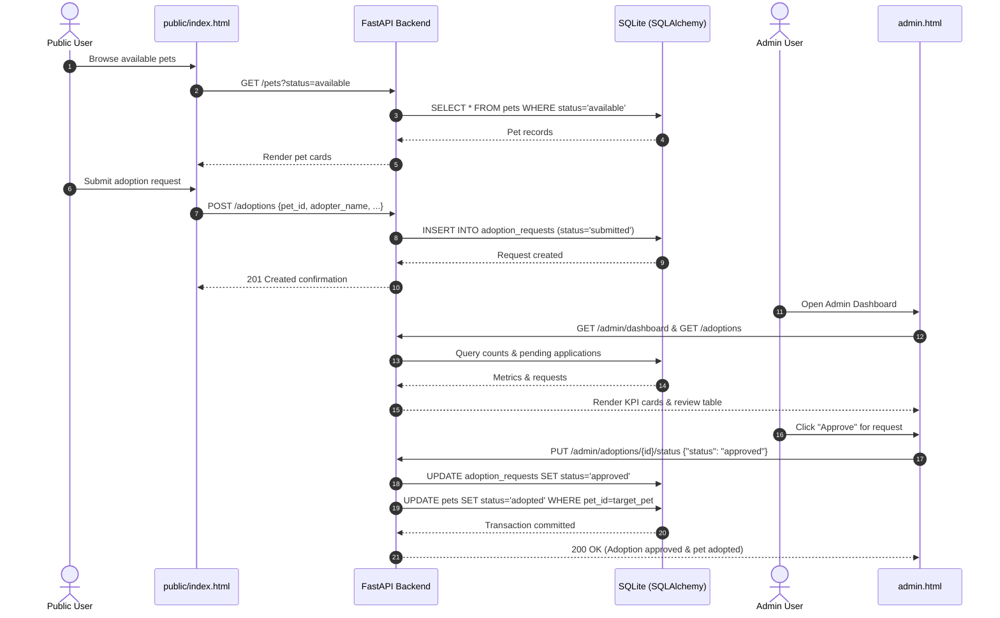

# Project Architecture  Pet Adoption & Management System

## 1. System Overview
The **Pet Adoption & Management System** utilizes a multi-tier, decoupled architecture designed for high maintainability, operational reliability, and clean separation of concerns.

```mermaid
flowchart TB
    subgraph Clients["Clients & Users"]
        PublicUser["Public User (Adopter)"]
        AdminUser["Operations Admin"]
    end

    subgraph Presentation["Presentation Layer (Static Portals)"]
        PublicUI["Public Adoption Portal<br/>(static/index.html)"]
        AdminUI["Administrative Dashboard<br/>(static/admin.html)"]
    end

    subgraph Ingress["Ingress & Networking"]
        K8sSvc["Kubernetes Service<br/>(LoadBalancer: Port 80)"]
    end

    subgraph Application["FastAPI Application (main.py)"]
        StaticMount["StaticFiles Mount<br/>(/static)"]
        HealthRoute["Health Routes<br/>(GET /, GET /health)"]
        
        subgraph Routers["API Routers"]
            PetsRouter["Pets Router<br/>(routers/pets.py)"]
            AdoptionsRouter["Adoptions Router<br/>(routers/adoptions.py)"]
            AdminRouter["Admin Router<br/>(routers/admin.py)"]
        end
    end

    subgraph DataLayer["Persistence Layer (SQLAlchemy 2.0)"]
        SessionMgr["Session Management<br/>(database.py: get_db)"]
        Models["Relational ORM Models<br/>(models.py: PetModel, AdoptionRequestModel)"]
        SQLiteDB[("SQLite Database<br/>(pets.db)")]
    end

    PublicUser -->|HTTP /| K8sSvc
    AdminUser -->|HTTP /admin.html| K8sSvc
    K8sSvc --> StaticMount
    K8sSvc --> HealthRoute
    
    PublicUI -->|GET /pets<br/>POST /adoptions| PetsRouter
    PublicUI -.-> AdoptionsRouter
    AdminUI -->|GET /admin/dashboard<br/>PUT /admin/adoptions/{id}<br/>DELETE /admin/pets/{id}| AdminRouter
    AdminUI -->|POST /pets| PetsRouter

    PetsRouter --> SessionMgr
    AdoptionsRouter --> SessionMgr
    AdminRouter --> SessionMgr
    SessionMgr --> Models
    Models --> SQLiteDB
```

---

## 2. Core Architectural Components

### 2.1 Persistence Layer (`database.py` & `models.py`)
- **Database Engine**: Powered by SQLAlchemy 2.0 with a persistent SQLite storage backend (`sqlite:///./pets.db`). Configured with `connect_args={"check_same_thread": False}` for multi-threaded FastAPI async handling.
- **Session Lifecycle**: The `get_db()` dependency establishes a thread-safe `SessionLocal()` generator yielding active sessions and guaranteeing cleanup via `finally: db.close()`.
- **Relational Schema**:
  - `PetModel` (`pets` table): Primary key `pet_id` (String), `name`, `species`, `breed`, `age`, `description`, `status` (`available`, `pending`, `adopted`). Has one-to-many relationship with `adoption_requests`.
  - `AdoptionRequestModel` (`adoption_requests` table): Primary key `request_id` (String), foreign key `pet_id` referencing `pets.pet_id` (with `ondelete="CASCADE"`), `adopter_name`, `adopter_email`, `message`, `status` (`submitted`, `approved`, `rejected`).
- **Startup Table Creation**: `init_db()` is invoked during application startup in `main.py` (`Base.metadata.create_all(bind=engine)`), automatically provisioning tables if absent.

### 2.2 Presentation Layer & Frontend Separation
The frontend interface is strictly separated into two independent portals:

1. **Public Adoption Portal (`static/index.html`)**:
   - **Target Audience**: Prospective pet adopters and general public.
   - **Capabilities**: View active pet catalog, filter by species/status, inspect pet details, and submit adoption applications.
   - **Isolation Guarantee**: Strictly devoid of administrative controls, KPI displays, approval/rejection triggers, or `/admin/*` API calls.

2. **Admin Operations Dashboard (`static/admin.html`)**:
   - **Target Audience**: Shelter managers and administrative staff.
   - **Capabilities**:
     - **Operations KPIs**: Displays live counts for total pets, available pets, adopted pets, and pending applications (`GET /admin/dashboard`).
     - **Application Review Queue**: Lists all submitted adoption requests with one-click **Approve** and **Reject** buttons (`PUT /admin/adoptions/{id}/status`).
     - **Pet Inventory Management**: Register new pets (`POST /pets`), update availability status (`PUT /admin/pets/{id}/status`), and remove listings (`DELETE /admin/pets/{id}`).
   - **Business Logic Cascade**: Approving an adoption request automatically cascades the associated pet's status from `available`/`pending` to `adopted`.

### 2.3 API Router Architecture (`routers/`)
- `routers/pets.py`: Handles pet registration (`POST /pets`), catalog listings with filtering (`GET /pets`), and single-record retrieval (`GET /pets/{pet_id}`).
- `routers/adoptions.py`: Handles adoption application submissions (`POST /adoptions`), application listing (`GET /adoptions`), and lookup (`GET /adoptions/{request_id}`). Enforces pet availability validation.
- `routers/admin.py`: Provides administrative KPI metrics (`GET /admin/dashboard`), adoption approval/rejection with pet status cascade (`PUT /admin/adoptions/{request_id}/status`), pet status updates (`PUT /admin/pets/{pet_id}/status`), and pet record deletion (`DELETE /admin/pets/{pet_id}`).

---

## 3. Adoption Lifecycle Flow


---

## 4. DevOps & Deployment Architecture
- **Containerization (`Dockerfile`)**: Lightweight Python 3.11/3.12 container running Uvicorn. Excludes runtime database and test caches via `.dockerignore`.
- **CI/CD Pipeline (`Jenkinsfile`)**: Declarative pipeline orchestrating checkout, dependency installation, pytest automated testing, Docker build, and Kubernetes deployment.
- **Kubernetes Orchestration (`k8s/`)**: Deployment manifest managing pod replicas and resource specifications, coupled with a LoadBalancer Service exposing port 80.
- **Team Distribution Architecture (`team_distribution_v2/`)**: Clean 20-file manifest across 10 specialized student roles with zero overlap and zero runtime pollution.
